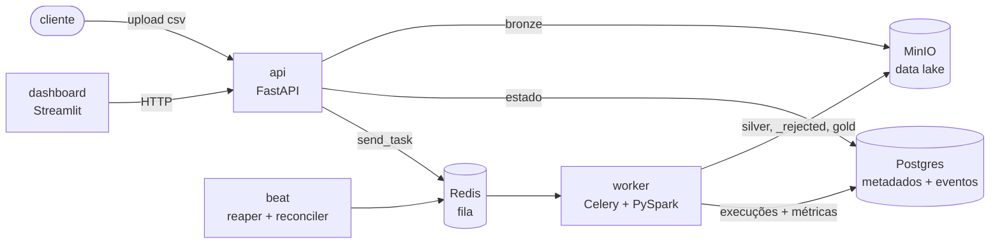

# DataFlow

Plataforma genérica de ingestão de dados tabulares: cadastra o schema uma vez,
e qualquer CSV daquele dataset é validado, armazenado em camadas Medallion
(Bronze/Silver/Gold) e fica observável, sem escrever pipeline novo.

## O problema e a proposta

Todo projeto que recebe dados de fontes diferentes acaba com um pipeline
ad-hoc por fonte: código duplicado pra ler e validar, nenhum padrão de erro
ou retry, nenhum histórico do arquivo original e nenhuma forma de saber o que
aconteceu com um upload específico.

No DataFlow o schema é **dado, não código**. Você cadastra os campos de um
dataset (tipo, obrigatoriedade, mínimo/máximo) via API; a partir daí cada
upload vira uma Bronze imutável no MinIO, um worker Celery roda PySpark pra
separar linhas válidas e rejeitadas (Silver) e calcular métricas de qualidade
(Gold), e o Postgres guarda o estado de cada etapa.

O foco do projeto é o que acontece **quando algo dá errado**: idempotência
garantida pelo banco, retry só pra falha de infraestrutura, recuperação de
requisições perdidas e de workers que morrem no meio, e rastreio ponta a
ponta de cada ingestão, do cliente até o data lake.

## Arquitetura



| Camada | O que guarda |
|---|---|
| **Bronze** | o arquivo original, imutável, pra auditoria e reprocessamento |
| **Silver** | Parquet tipado com as linhas válidas + Parquet `_rejected` com as inválidas |
| **Gold** | uma linha de métricas por execução (válidas, rejeitadas, taxa, duração) |

Detalhes de cada fluxo, modelo de dados e padrões em
[`docs/arquitetura.md`](docs/arquitetura.md).

## Como rodar

Pré-requisito: Docker com Docker Compose.

```bash
cp .env.example .env
docker compose up -d --build
```

| Serviço | URL |
|---|---|
| API (Swagger) | http://localhost:8000/docs |
| Dashboard | http://localhost:8501 |
| Console do MinIO | http://localhost:9001 (`minioadmin` / `minioadmin`) |

### Primeiro uso

```bash
# 1. cadastra um dataset
ID=$(curl -s -X POST localhost:8000/datasets/ -H 'content-type: application/json' -d '{
  "name": "vendas", "format": "csv",
  "schema": {"fields": [
    {"name": "data", "type": "date", "required": true},
    {"name": "produto", "type": "string", "required": true},
    {"name": "qtd", "type": "integer", "required": true, "min": 1},
    {"name": "valor", "type": "float", "required": true, "min": 0.01}
  ]}}' | python3 -c 'import sys,json;print(json.load(sys.stdin)["id"])')

# 2. manda 20 CSVs sintéticos com 10% de linhas inválidas (rota só em ENV=development)
curl -s -X POST "localhost:8000/dev/bulk-ingest?dataset_id=$ID&count=20&rows=1000&invalid_rate=0.1"
```

3. Abra o dashboard → página **trace** e acompanhe cada CSV passando por
   API, MinIO, Redis, worker e Postgres.

Pra um upload real: `POST /datasets/{id}/ingest` com o arquivo em
multipart (`?mode=sync` espera o pipeline terminar).

## O que a plataforma garante

| Situação | Comportamento |
|---|---|
| Mesma Bronze processada duas vezes (retry, mensagem duplicada) | um **índice único parcial** no Postgres impede duas Silvers ativas; a segunda task desiste sem erro |
| MinIO ou Postgres fora no meio do processamento | retry com backoff exponencial, só pra erro de infraestrutura (erro de dado não repete) |
| **Redis fora no envio pra fila** | a API responde 202 (a Bronze já está salva) e registra a requisição como perdida; o **reconciler** reenfileira depois |
| **Worker morre no meio do Spark** | o **reaper** marca a execução presa como FAILED por timeout; o reconciler reenfileira a Bronze |
| Job lento termina depois do timeout | o estado terminal não volta atrás: o reaper vence (`UPDATE ... WHERE status='RUNNING'`) |

Todos esses cenários são reproduzíveis em minutos com
`docker-compose.demo.yml` (timeouts curtos). Passo a passo em
[`docs/roteiro-testes.md`](docs/roteiro-testes.md).

## Rastreio de cada ingestão

Cada passo vira um evento na tabela `execution_event` com o id da Bronze como
`trace_id`, e a mesma linha vai pro log. Três formas de ver:

- **dashboard → trace:** grafo com cor por estado (requisição perdida em
  vermelho, recuperação em laranja) e linha do tempo com o tempo entre passos
- **API:** `GET /traces/{execution_id}`
- **logs:** `docker compose logs -f api worker | grep trace=<id>`

Rastreio real de uma ingestão de 500 linhas (worker recém-iniciado, por isso
os ~17s do Spark; ver "Por que Spark?"):

```text
23:24:52.932 api        received           synthetic_0.csv recebido
23:24:53.369 api        bronze_stored      bronze gravada no minio
23:24:53.962 api        enqueued           task enfileirada no redis
23:24:54.547 worker     silver_started     worker pegou a bronze
23:24:55.045 worker     bronze_downloaded  bronze baixada do minio
23:25:12.041 worker     spark_validated    500 linhas: 398 validas, 102 rejeitadas
23:25:16.566 worker     silver_stored      silver e _rejected gravadas no minio
23:25:17.068 worker     gold_started       calculando metricas da silver
23:25:31.896 worker     gold_stored        gold e metricas gravadas: 20.4% rejeitadas
```

## Por que Spark?

**Pro volume atual, pandas seria a escolha certa.** Medido dentro do worker,
com 1000 linhas:

| | subir o Spark | ler + validar | gravar Parquet | total |
|---|---|---|---|---|
| 1ª task do processo (JVM fria) | 4,7s | 4,3s | 1,0s | ~10s |
| tasks seguintes (JVM quente) | 0,1s | 0,6s | 0,1s | ~1s |

O custo é quase todo fixo (partida da JVM e aquecimento do JIT), e pandas
faria o mesmo em milissegundos. O Spark está aqui como **objeto de estudo**:
lazy evaluation, transformations vs. actions, schema dinâmico com
`StructType`, modo `PERMISSIVE` com `_corrupt_record`. Ele passa a valer a
pena quando o processamento leva minutos e a partida vira ruído.

## Stack

FastAPI · Uvicorn · PostgreSQL 16 · SQLAlchemy 2 · Alembic · MinIO (S3) ·
Redis · Celery · PySpark 4 (`local[*]`) · PyArrow · Streamlit · Docker
Compose · uv workspace · pytest · ruff · black

## Desenvolvimento

Pré-requisitos: [uv](https://docs.astral.sh/uv/) e **Java 21** pros testes
que usam Spark.

```bash
uv sync --all-packages
export JAVA_HOME=$(/usr/libexec/java_home -v 21)   # macOS
uv run pytest -q                                   # 121 testes
uv run ruff check . && uv run black --check .
```

Os testes rodam contra Postgres e MinIO reais do compose, num banco próprio
(`dataflow_test`) criado com as migrations do Alembic: rodar a suíte não
apaga os dados do ambiente.

```text
dataflow/
├── alembic/                  # migrations
├── libs/dataflow_common/     # models, repository, storage, eventos de rastreio
├── services/
│   ├── api/                  # FastAPI: datasets, ingestão, consulta, traces
│   ├── processing/           # Celery + PySpark: bronze→silver→gold, reaper, reconciler
│   └── dashboard/            # Streamlit
├── tests/                    # unit, integration, processing, migrations
└── docs/                     # arquitetura e roteiro de testes
```

## Como o projeto evoluiu

| Versão | Entrega |
|---|---|
| V0 | FastAPI + Postgres + cadastro de dataset com schema em JSONB |
| V1 | ingestão pra Bronze no MinIO |
| V2 | PySpark: Bronze → Silver com validação dinâmica pelo schema |
| V3 | Gold com métricas de qualidade |
| V4 | API de consulta de execuções e métricas |
| V5a–d | Celery + Redis, retry e reaper, dashboard, paginação e endpoints de demo |
| V5e | revisão de arquitetura: idempotência no banco, reconciler, concorrência do worker medida |
| V5f | rastreio ponta a ponta (eventos, logs com `trace_id`, página trace) |

Limites conhecidos em [`docs/arquitetura.md`](docs/arquitetura.md#10-limites-conhecidos).
