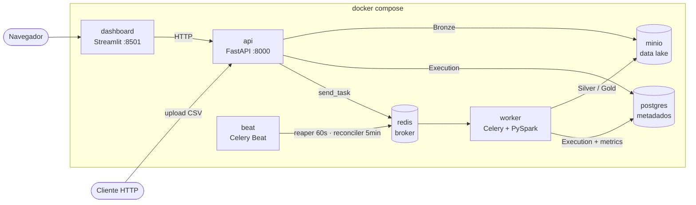
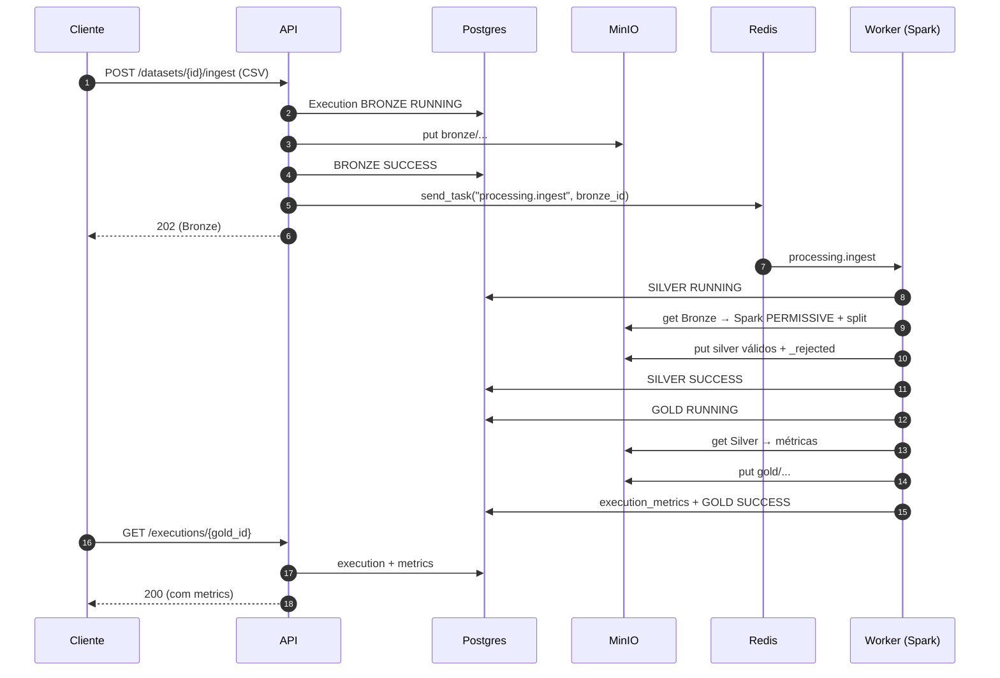

# Arquitetura — o que existe hoje

> Retrato do código na `v1.0.0`. Descreve só o que está no repositório.
> As versões citadas (V5a…V5f) são as etapas em que cada parte entrou.

## 1. O que a plataforma faz

Recebe CSVs via HTTP, valida contra um schema cadastrado pelo usuário e
produz 3 camadas no padrão Medallion no object storage:

- **Bronze**: arquivo original, imutável, guardado pra auditoria.
- **Silver**: Parquet tipado com as linhas válidas, mais um Parquet
  paralelo com as linhas rejeitadas, pra inspeção.
- **Gold**: Parquet com uma linha por execução contendo métricas de
  qualidade (contagem de válidos/rejeitados, taxa de rejeição, duração).

O processamento Bronze → Silver → Gold é **disparado automaticamente**
quando a ingestão termina: a API enfileira uma task no Celery e um worker
roda o Spark. Uma API de consulta e um dashboard Streamlit mostram
datasets, execuções, métricas e as linhas rejeitadas.

**O que a plataforma não faz:** não ingere em schedule (o beat agenda
só manutenção: reaper e reconciler), não reprocessa execução que falhou
por erro de dado, não aceita JSON (V6), não notifica, não tem
autenticação, não roda em cluster (o Spark roda em `local[*]` dentro do
worker).

## 2. Topologia (o que roda)

Tudo sobe com `docker compose up -d`:



| Serviço | Imagem | Papel |
|---------|--------|-------|
| `postgres` | `postgres:16-alpine` | Metadados: `dataset`, `execution`, `execution_metrics`. Volume `postgres_data`. |
| `minio` | `alpine/minio` | Object storage compatível com S3. Volume `minio_data`. Bucket único: `dataflow`. Console em `:9001`. |
| `minio-init` | custom (`mc`) | Job que roda uma vez: cria o bucket e encerra (`exited`). |
| `redis` | `redis:7-alpine` | Broker do Celery. Sem result backend (`backend=None`). |
| `db-migrate` | build da API | Job que roda uma vez: `alembic upgrade head`. API, worker e beat só sobem depois que ele termina com sucesso. |
| `api` | `services/api/Dockerfile` | FastAPI na porta 8000, com `--reload` e bind-mount do `src`. |
| `worker` | `services/processing/Dockerfile` | Celery worker com JRE 21 + PySpark. Roda as tasks. `--concurrency=${WORKER_CONCURRENCY:-2}`: cada processo filho sobe a própria JVM (ver 3.3). |
| `beat` | `services/processing/Dockerfile` | Celery Beat: agenda `reap_stuck_executions` (60s) e `reconcile_bronzes` (5 min). |
| `dashboard` | `services/dashboard/Dockerfile` | Streamlit na porta 8501. Fala **só com a API** (`API_URL=http://api:8000`), nunca direto com Postgres ou MinIO. |

Todos os serviços que ficam rodando têm `restart: unless-stopped`: se um
cair sozinho (ex.: OOM no worker), o Docker reinicia. `minio-init` e
`db-migrate` são jobs de uma vez e não reiniciam. Parada manual
(`docker compose stop`/`kill`) não dispara o restart.

A assimetria da V2–V4 (API no compose, Spark rodando no host) **acabou na
V5a**: o Spark agora roda dentro do container `worker`. Os CLIs
(`python -m processing.bronze_to_silver <id>`) continuam existindo pra
debug, mas não fazem mais parte do fluxo normal.

## 3. Fluxo de dados ponta a ponta

### 3.1 Cadastro do dataset (uma vez)

```
POST /datasets/
{
  "name": "vendas",
  "format": "csv",          # único aceito (Literal["csv"])
  "schema": {
    "fields": [
      {"name": "produto", "type": "string", "required": true},
      {"name": "quantidade", "type": "integer", "required": true, "min": 1}
    ]
  }
}
```

Validação Pydantic (`services/api/src/api/schemas.py`):
- `FieldSchema` valida os tipos permitidos (`date|string|integer|float`)
  e só aceita `min/max` em campo numérico.
- `DatasetSchema` valida que não há nomes de campo duplicados.
- `DatasetCreate` tem o alias `schema` ↔ `dataset_schema` (o nome
  `schema` é reservado no Pydantic).

O handler (`routers/datasets.py`) checa duplicata por nome (409) e grava
o schema **inteiro em JSONB**.

### 3.2 Upload → Bronze → enfileiramento

```
POST /datasets/{dataset_id}/ingest?mode=async   (default)
file=@vendas.csv
```

O router (`routers/ingestion.py`) só resolve o dataset e lê os bytes. O
trabalho fica em `services/ingest.py::ingest_bytes`, extraída na V5d pra
ser reaproveitada pelo `/dev/bulk-ingest`:

1. Cria `Execution(layer=BRONZE, status=RUNNING)`.
2. Valida o tamanho (`max_file_size_mb`, default 100).
3. Valida que o conteúdo é `utf-8`. Dataset legado com `format != csv`
   falha aqui, de forma explícita. A validação contra o schema do
   dataset **não** acontece aqui, ela é feita pelo Spark.
4. Calcula o SHA-256 e sobe o arquivo pro MinIO em
   `bronze/{dataset}/ano=YYYY/mes=MM/dia=DD/{execution_id}_{file_name}`.
5. Marca a Bronze como `SUCCESS` com `file_size`, `checksum` e `storage_path`.
6. **`celery_client.send_task("processing.ingest", args=[bronze_id])`**:
   a API não importa o código do worker, só manda o nome da task pro Redis.

Respostas:
- `mode=async` → `202` com a Execution Bronze. O cliente acompanha por
  `GET /executions/`.
- `mode=sync` → a API faz polling no Postgres (1s) e devolve `200` com
  o resultado final: a Gold (`SUCCESS/FAILED`) ou, se o pipeline parou
  antes, a Silver `FAILED`. Timeout de 300s → `504`. Detalhes:
  - Olha sempre a filha **mais recente** de cada camada, porque com
    retry a mesma Bronze pode ter várias Silvers.
  - Uma execução `FAILED` só vale como resultado depois de 90s sem
    tentativa nova (`_SYNC_FAILED_GRACE_SECONDS`), janela maior que o
    backoff máximo do retry (60s). Senão devolveria FAILED no meio de um
    retry que ainda pode dar certo.
  - `db.close()` a cada volta devolve a conexão ao pool durante o
    `sleep`. A thread continua presa (ver Limites).
- MinIO fora do ar → Bronze `FAILED` e resposta `503`.
- Erro de entrada → Bronze `FAILED` registrada e resposta **4xx** com a
  Execution no corpo (o cliente fica com o id): arquivo acima de
  `max_file_size_mb` → `413`; encoding inválido ou formato não suportado →
  `400`. Nada é enfileirado.
- Erro inesperado (bug) → Bronze `FAILED` e `500`.

### 3.3 Task `processing.ingest` (worker)

Definida em `services/processing/src/processing/tasks.py`. Ela só
encadeia as duas etapas:

```python
silver_id = bronze_to_silver.run(bronze_id)
gold_id   = silver_to_gold.run(silver_id)
```

**Retry:** `autoretry_for=(OperationalError, StorageUnavailableError)`,
backoff exponencial com jitter (até 60s), `max_retries=3`. Só tenta de
novo em falha de **infraestrutura** (Postgres ou MinIO fora). Erro de
dado ou de código falha na hora, porque repetir não resolveria.

Retry é seguro por causa da **idempotência** das duas etapas, feita em
`processing/idempotency.py::start_child_execution`:

1. Caminho rápido: se já existe filha `SUCCESS`, devolve o id dela
   (`[Skip]`). Se a Silver terminou e a Gold falhou, o retry pula a
   Silver e refaz só a Gold.
2. Garantia real: **índice único parcial** `uq_execution_child_active`
   em `(input_execution_id, layer) WHERE status IN ('RUNNING','SUCCESS')`.
   Se duas tasks da mesma Bronze passarem juntas pelo SELECT, a segunda
   toma `IntegrityError` no INSERT. Se a concorrente já terminou, vira
   `[Skip]`. Se ainda está rodando, levanta `ConcurrentExecutionError`, e
   a task desiste **sem falhar** (a outra faz o trabalho).

Uma tentativa que falhou deixa sua Execution em `FAILED` no banco, e o
retry cria uma nova. FAILED fica fora do índice, então isso funciona. O
histórico mostra as tentativas, o que é intencional (auditoria).

**Regra que sustenta isso:** tudo que pode falhar depois de criar a
filha RUNNING (download do MinIO, boot da JVM) fica **dentro** do `try`
que marca FAILED. Se ficasse fora, a filha ficaria RUNNING, o índice
bloquearia o retry e a task desistiria sem processar. Esse bug existiu e
foi pego no teste de carga da V5e.

**Erros que não devem ter retry:** `PreconditionError` (a Execution de
entrada não está processável) não está em `autoretry_for`. Os `run()`
nunca levantam `SystemExit`: dentro de uma task Celery, isso derrubaria
o processo filho do pool. Só o `main()` da CLI converte.

**Uma JVM por processo:** o Celery prefork cria N processos filhos, e
cada um sobe sua própria JVM com `local[*]` na primeira task. Medido num
Docker com 8 CPUs/4 GB: com o default (8 processos), as JVMs morreram e
só 5 de 20 ingestões terminaram em 195s. Com `WORKER_CONCURRENCY=2`, 20
de 20 em 48s, pico de 2,3 GB.

#### Bronze → Silver (`bronze_to_silver.run`)

1. Valida as pré-condições (a Bronze existe, é `BRONZE` e tem `storage_path`).
2. Checa a idempotência (descrita acima).
3. Cria `Execution(layer=SILVER, status=RUNNING, input_execution_id=bronze_id)`.
4. Baixa a Bronze do MinIO pra `/tmp`.
5. **Monta o `StructType` do Spark dinamicamente** a partir do schema
   JSONB (`schema_mapper.py`), mais a coluna `_corrupt_record`.
6. `spark.read.csv(..., mode="PERMISSIVE", columnNameOfCorruptRecord="_corrupt_record")`:
   linha malformada vira uma linha com campos NULL e o texto original em
   `_corrupt_record`, em vez de ser descartada sem aviso.
7. **Separa válidos e rejeitados:** monta uma coluna booleana com `AND`
   de todas as regras (`_corrupt_record IS NULL`, obrigatórios
   `NOT NULL`, `>= min`, `<= max`) e filtra por ela e pela negação dela.
8. Grava os dois DataFrames com `coalesce(1)` e sobe pro MinIO:
   - válidos: `silver/{dataset}/dt=YYYY-MM-DD/{silver_id}.parquet`
   - rejeitados: `silver/{dataset}/_rejected/{silver_id}.parquet`
9. `SUCCESS` com `storage_path` = Parquet dos válidos. O caminho dos
   rejeitados é derivado por convenção (`build_silver_rejected_path`).
10. Se der exception: `FAILED` com `error_message` e re-raise (é isso que
    aciona o retry). `spark.stop()` fica no `finally`.

#### Silver → Gold (`silver_to_gold.run`)

1. Valida as pré-condições (é `SILVER`, está `SUCCESS` e tem timestamps)
   e checa a idempotência.
2. Cria `Execution(layer=GOLD, status=RUNNING, input_execution_id=silver_id)`.
3. Baixa os dois Parquets da Silver e lê com `spark.read.parquet` (o
   schema vem do próprio Parquet).
4. Calcula `valid_count`, `rejected_count`, `rejection_rate`,
   `corrupt_count` e `duration_seconds` (este último vem dos timestamps
   da **Silver**).
5. Cria um DataFrame de uma linha, grava em
   `gold/{dataset}/dt=YYYY-MM-DD/{gold_id}.parquet`.
6. Insere a linha em `execution_metrics` (FK UNIQUE pra Gold). O Parquet
   continua sendo a verdade analítica; o Postgres funciona como índice
   do data lake.
7. `SUCCESS`. O `commit` do `finish_execution` confirma a transação
   inteira, incluindo as métricas.

### 3.4 Reaper e reconciler (beat)

Os dois cobrem metades diferentes do mesmo problema: o reaper corrige o
**estado**, o reconciler recupera o **trabalho**.

**Reaper** (`processing.reap_stuck_executions`, a cada 60s): marca como
`FAILED` (`error_message="timeout"`) toda Execution em `RUNNING` com
`started_at` mais antigo que `execution_timeout_minutes` (default 30).
Resolve o caso em que o worker morre no meio do Spark (OOM,
`docker kill`), o `except` nunca roda e a Execution ficaria `RUNNING`
pra sempre.

Se o job estava só lento e termina depois do reaper, o `finish_execution`
não sobrescreve: ele é um `UPDATE ... WHERE status = 'RUNNING'`, e com 0
linhas afetadas levanta `ExecutionAlreadyFinishedError`. **O reaper
vence**, e estado terminal não volta atrás.

**Reconciler** (`processing.reconcile_bronzes`, a cada 5 min):
reenfileira `processing.ingest` pra Bronzes `SUCCESS` terminadas há mais
de 10 min e há menos de 24h que:

1. não têm nenhuma Silver filha. O `send_task` se perdeu (Redis fora, ou
   a API caiu entre o commit e o enfileiramento). É o problema clássico
   de *dual write*;
2. ou só têm Silvers `FAILED` por `"timeout"`, e menos de 3. O worker
   morreu, o reaper marcou, e a mensagem já tinha sido confirmada no
   Redis (sem `acks_late`), então ninguém mais a entregaria.

Silver `FAILED` por outro motivo (erro de dado, retry esgotado) não é
reenfileirada, porque repetir não resolve.

A ideia por trás: **a tabela `execution` já funciona como outbox**. Uma
Bronze `SUCCESS` sem Silver é, por definição, uma tarefa que deveria
estar na fila. Não precisa de tabela de outbox separada, só de alguém
que olhe pra ela. Reenfileirar é seguro por causa do índice de
idempotência (3.3).

### 3.5 Consulta via API

- `GET /datasets/` e `GET /datasets/{id}`.
- `GET /executions/`: filtros `dataset` (nome), `status`, `layer`,
  `from`, `to` (datas inclusivas). **Paginação por cursor** (V5d):
  resposta `{items, next_cursor}`, `limit` entre 1 e 200 (default 50) e
  `after=<cursor>` pra próxima página. O cursor é `(created_at, id)` em
  base64, e a comparação é por tupla (`(created_at, id) < cursor`), o que
  mantém a ordenação estável mesmo com timestamps iguais.
- `GET /executions/{id}`: detalhe. O bloco `metrics` só vem preenchido
  quando a execução é Gold e tem linha em `execution_metrics`.
- `GET /executions/{silver_id}/rejected?limit=20`: baixa o Parquet de
  rejeitados e devolve as linhas como JSON (via `pyarrow`, sem Spark). É
  o que alimenta o preview no dashboard.

### 3.6 Endpoints de desenvolvimento (`/dev/*`)

Só são registrados quando `ENV=development` (`create_app()` em
`main.py`). Em produção a rota não existe e responde `404`, sem
precisar de nenhuma checagem dentro do handler.

- `POST /dev/csv/sample?dataset_id=&rows=&invalid_rate=`: gera um CSV
  sintético que segue o schema do dataset, com uma fração de linhas
  inválidas (60% campo obrigatório nulo, 30% fora do range, 10% tipo
  errado).
- `POST /dev/bulk-ingest?dataset_id=&count=&rows=&invalid_rate=`: gera
  `count` CSVs (máximo 50) e chama `ingest_bytes` pra cada um. Devolve
  `202` com os `execution_ids`. Serve pra demo e teste de carga manual.

### 3.7 Dashboard

Streamlit com 4 páginas (`services/dashboard/src/dashboard/pages/`):

- **Overview**: KPIs e execuções recentes.
- **Por dataset**: histórico de ingestões de um dataset.
- **Detalhe**: uma execução, com métricas da Gold e preview das linhas
  rejeitadas da Silver.
- **Trace**: o caminho de uma ingestão como grafo, com a linha do tempo
  (ver 3.8).

Todas as chamadas passam por `api_client.py`. O dashboard é um cliente
da API como qualquer outro e não tem acesso ao banco.

### 3.8 Rastreio (V5f)

Cada passo de uma ingestão vira uma linha em `execution_event`, com
`trace_id` = id da Bronze. O helper `dataflow_common.events.trace_event()`
grava o evento **e** loga a mesma linha (`trace=<id> service.step mensagem`),
em sessão própria: falha ao gravar não derruba o pipeline e o evento de erro
sobrevive ao rollback da etapa.

- Leitura: `GET /traces/{execution_id}` (aceita qualquer camada, sobe até a
  Bronze) devolve a cadeia e os eventos.
- Visual: página "trace" do dashboard, grafo graphviz com cor por estado e
  timeline com delta entre passos, auto-refresh 2s.
- Logs: `docker compose logs -f api worker | grep trace=<id>`.
- Redis fora no `send_task` → 202 + `enqueue_failed`; o reconciler recupera.
  Pra demo: `RECONCILE_AFTER_MINUTES=1` e `RECONCILE_INTERVAL_SECONDS=30`.

## 4. Modelo de dados

Três tabelas (`libs/dataflow_common/src/dataflow_common/models.py`). Desde a migration `d4b8e2f71a36` (refactor pré-v1.0.0) colunas e chaves do JSONB estão em inglês; a migration converte datasets antigos (`campos/nome/tipo/obrigatorio` → `fields/name/type/required`). O
schema é aplicado por **Alembic** (`alembic/versions/`), rodado pelo
serviço `db-migrate`. O `create_all()` no startup da API foi removido.

### `dataset`
| Coluna | Tipo | Notas |
|--------|------|-------|
| `id` | UUID | PK |
| `name` | String | UNIQUE |
| `format` | String | `csv` ou `json` |
| `schema` | JSONB | O schema do usuário, inteiro. **É dado, não código.** |
| `created_at` | TimestampTZ | default now() |

### `execution`
| Coluna | Tipo | Notas |
|--------|------|-------|
| `id` | UUID | PK |
| `dataset_id` | UUID | FK → dataset.id |
| `input_execution_id` | UUID | FK → execution.id (aponta pra própria tabela). Encadeia Bronze ← Silver ← Gold. |
| `layer` | String | `BRONZE` / `SILVER` / `GOLD` |
| `status` | String | `RUNNING` / `SUCCESS` / `FAILED` (`PENDING` é o default do modelo, mas nenhum fluxo usa) |
| `created_at`, `started_at`, `finished_at` | TimestampTZ | |
| `error_message` | Text | preenchido em `FAILED` (`"timeout"` quando vem do reaper) |
| `file_name`, `file_size`, `checksum` | | só preenchidos na Bronze |
| `storage_path` | String | caminho no MinIO (Bronze: original; Silver: Parquet válido; Gold: Parquet de métricas) |

Índice `uq_execution_child_active`: único parcial em
`(input_execution_id, layer) WHERE status IN ('RUNNING','SUCCESS')`.
Garante no máximo uma filha ativa por pai e camada (ver 3.3). A Bronze
tem `input_execution_id` NULL, e NULLs não colidem.

### `execution_event`
| Coluna | Tipo | Notas |
|--------|------|-------|
| `id` | UUID | PK |
| `trace_id` | UUID | FK → execution.id: a **Bronze** raiz da cadeia |
| `execution_id` | UUID | FK → execution.id: a execução do passo (nullable) |
| `service` | String | `api`, `worker`, `reaper`, `reconciler` |
| `step` | String | `received`, `enqueued`, `spark_validated`, `gold_stored`, `enqueue_failed`, `timeout`, `requeued`… |
| `message` | Text | linha legível (a mesma que vai pro log) |
| `details` | JSONB | contagens, caminhos, erro |
| `created_at` | TimestampTZ | índice `(trace_id, created_at)` |

### `execution_metrics`
| Coluna | Tipo | Notas |
|--------|------|-------|
| `id` | UUID | PK |
| `gold_execution_id` | UUID | FK → execution.id, **UNIQUE** |
| `valid_count`, `rejected_count`, `corrupt_count` | BigInt | |
| `rejection_rate`, `duration_seconds` | Float | |
| `created_at` | TimestampTZ | |

## 5. Convenções do data lake (MinIO)

Bucket único: `dataflow`. Os caminhos são construídos em
`libs/dataflow_common/src/dataflow_common/storage.py`:

```
bronze/<dataset>/ano=YYYY/mes=MM/dia=DD/<execution_id>_<file_name>
silver/<dataset>/dt=YYYY-MM-DD/<execution_id>.parquet
silver/<dataset>/_rejected/<execution_id>.parquet
gold/<dataset>/dt=YYYY-MM-DD/<execution_id>.parquet
```

- Bronze mantém o nome original do arquivo, pra auditoria.
- Os rejeitados ficam no namespace `_rejected`, fora da partição por
  data, e por isso **não** entram em consultas analíticas da Silver.

## 6. Organização do código

Monorepo com **uv workspace**:

```
dataflow/
├── pyproject.toml              # raiz do workspace + pytest/ruff/mypy
├── docker-compose.yml
├── alembic/                    # migrations (db-migrate)
├── libs/
│   └── dataflow_common/        # models, repository, storage, events (trace_event)
├── services/
│   ├── api/src/api/
│   │   ├── main.py             # create_app() + registro condicional do /dev
│   │   ├── celery_client.py    # Celery só pra send_task (não importa tasks)
│   │   ├── services/ingest.py  # ingest_bytes: Bronze + enfileiramento
│   │   ├── dev_utils.py        # gerador de CSV sintético
│   │   └── routers/            # datasets, executions, ingestion, traces, dev
│   ├── processing/src/processing/
│   │   ├── celery_app.py       # app Celery + beat_schedule
│   │   ├── tasks.py            # ingest (com retry), reaper, reconciler
│   │   ├── idempotency.py      # start_child_execution (SELECT + índice)
│   │   ├── errors.py           # PreconditionError, ConcurrentExecutionError
│   │   ├── bronze_to_silver.py # run() + CLI de debug
│   │   ├── silver_to_gold.py   # run() + CLI de debug
│   │   ├── schema_mapper.py    # JSONB → StructType
│   │   └── spark.py            # SparkSession local[*]
│   └── dashboard/src/dashboard/
│       ├── app.py, styles.py
│       ├── api_client.py       # único ponto de I/O
│       ├── trace_graph.py      # monta o grafo (dot) e a timeline, sem streamlit
│       └── pages/              # overview, dataset, execution, trace
└── tests/
    ├── unit/                   # grafo do rastreio (sem infra)
    ├── integration/            # API (TestClient + Postgres real)
    ├── migrations/             # migration de dados (upgrade/downgrade)
    └── processing/             # Spark, task, reaper (Postgres + MinIO reais)
```

Pontos de atenção:
- `dataflow_common` é a fonte única do schema do banco e das convenções
  de caminho. API e worker importam dele, mas **não importam um ao
  outro**: a única ligação entre os dois é o nome da task no Redis.
- Cada serviço tem seu próprio `config.py` (pydantic-settings), e todos
  leem o mesmo `.env` com `extra="ignore"`.

## 7. Padrões que se repetem

### Execution como unidade de trabalho
Toda etapa é uma `Execution` que vai de `RUNNING` pra `SUCCESS` ou
`FAILED`, encadeada por `input_execution_id`. Isso dá auditoria
(qual Bronze virou qual Gold), idempotência barata (uma query por
`input_execution_id + layer + status`) e um modelo único pra consulta.

### Idempotência + retry (+ reconciler)
O retry e o reconciler só são seguros porque cada etapa é idempotente.
Retry sem idempotência duplicaria Silver/Gold; idempotência sem retry
deixaria falhas transitórias como erro definitivo. A idempotência é
**garantida pelo banco** (índice único parcial), não por convenção no
código: um SELECT seguido de INSERT não protege contra duas tasks ao
mesmo tempo.

### Fail-closed + reaper + reconciler
O `try/except` em cada etapa garante `FAILED` quando o Python consegue
reagir. O reaper cobre o caso em que o processo morre antes de reagir. O
reconciler devolve à fila o trabalho que o reaper só marcou como
perdido. Juntos: nenhuma Execution fica `RUNNING` pra sempre, e nenhuma
Bronze fica esquecida sem motivo.

### Estado terminal não volta atrás
`finish_execution` só transiciona a partir de `RUNNING`. Quem chega
depois (o job lento depois do reaper) recebe erro em vez de reescrever
o histórico.

### Ida e volta pelo `/tmp`
O Spark não lê o MinIO direto, porque isso exigiria o JAR `hadoop-aws`.
O padrão é `download → /tmp → Spark → /tmp → upload`. É menos elegante,
mas evita JARs no Spark. Aceito no contexto do projeto; seria dívida em
produção.

### `coalesce(1)` antes de gravar
Com arquivos pequenos, N partições só geram overhead. Uma partição gera
um arquivo, que é pego com `next(path.glob("part-*.parquet"))`.

### Schema como dado, não como código
O schema vive em JSONB e o código não tem classe por dataset. Adicionar
um dataset é um POST, não um deploy. O custo é perder a tipagem estática
dos dados do usuário.

## 8. Testes (121 verdes)

Banco próprio: `dataflow_test` (o `tests/conftest.py` cria se preciso,
zera o schema e roda `alembic upgrade head` uma vez por sessão). Rodar
`pytest` não toca nos dados do compose. O mesmo vale pro MinIO: os testes
usam o bucket `dataflow-test`, criado e esvaziado no início de cada sessão.

- `tests/integration/`: API via `TestClient`. `TRUNCATE ... CASCADE`
  antes de cada teste; `send_task` sempre com mock (sem Redis real). Cobre
  datasets, ingestão, modo sync (incluindo Silver FAILED e retry),
  consulta, paginação, preview de rejeitados, endpoints dev (incluindo o
  gate `ENV`, via `create_app()`) e o `finish_execution` condicional.
- `tests/processing/`: Bronze→Silver, Silver→Gold (incluindo falha no
  download), task `ingest` (retry, duplicata), índice de idempotência,
  reaper, reconciler e os eventos de rastreio de cada etapa. Postgres e
  MinIO reais.
- `tests/migrations/`: desce pra revisão anterior, grava dado no formato
  antigo, sobe e confere a conversão (e o caminho inverso).
- `tests/unit/`: estados e arestas do grafo de rastreio.

Os testes de Spark precisam de **Java 21** (`JAVA_HOME`); com o Java 24
o `JavaSparkContext` não sobe.

O boot do Spark (~5s por teste que usa Spark) domina o tempo da suíte.

## 9. Diagrama de sequência



## 10. Limites conhecidos

Os mais visíveis:

- `mode=sync` prende uma thread do threadpool (40) por até 300s. A
  conexão do banco já é liberada entre as voltas do polling.
- Se a JVM de um processo filho morre, aquele processo fica
  "envenenado": as próximas tasks nele recebem `Connection refused` do
  py4j até ele ser reciclado.
- `/dev/bulk-ingest` é síncrono dentro da API: `count=50, rows=100k`
  bloqueia a chamada por alguns segundos. Aceitável por ser dev-only.
- Spark em `local[*]` num container só: escala vertical, não horizontal.
  É uma escolha pedagógica, não uma limitação acidental. Com 2 processos no
  worker, cada JVM acha que tem todos os cores (16 threads de execução em 8
  cores); ajustar pra `local[cores/concorrência]` é a próxima otimização a
  medir.
- Pro volume atual, pandas seria mais rápido que Spark: o custo é quase todo
  a partida da JVM (~10s fria, ~1s quente). Ver "Por que Spark?" no README.
- Sem autenticação em nenhum endpoint.
